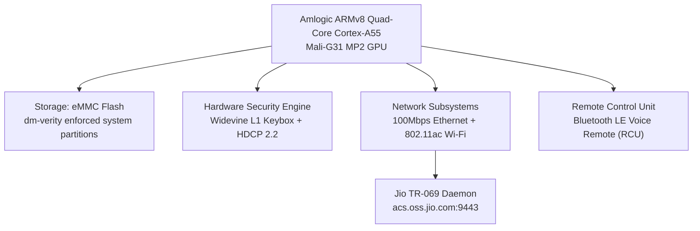
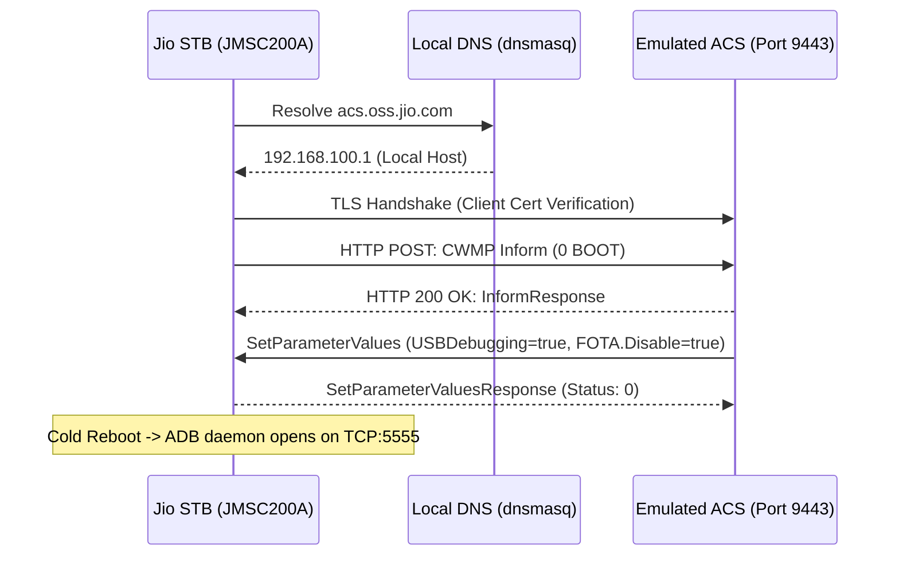

# Jio STB (Model: JMSC200A / 4KOTTSTB) — Forensic Research & Optimization Report

[](https://github.com/dc-voltage)
[](https://github.com/dc-voltage)
[-green.svg)](https://github.com/dc-voltage)
[](LICENSE)

---

## 📌 Executive Summary

This repository documents the forensic hardware analysis, boot security, TR-069 remote management architecture, and system debloating methodology for the **Reliance Jio Set-Top Box (Model: JMSC200A / 4KOTTSTB)**. 

The device is an Amlogic ARMv8-powered 4K Android TV streaming client running a heavily restricted, locked version of **Android 11 (TeleOS 25.1.9)** manufactured by **Shenzhen SDMC Technology Co., Ltd.**. Standard developer settings and ADB toggles are intentionally stripped from the user interface. 

This research demonstrates how to re-enable developer access non-invasively via internal CWMP/TR-069 management vectors, disable OEM spyware and telemetry, and restore a clean, ad-free Leanback launcher while **100% preserving hardware DRM (Widevine L1 4K HDR) and Dolby Audio**.

---

## 🛠️ Hardware & Firmware Specifications



| Parameter | Specification | Details |
|---|---|---|
| **Device Model** | `JMSC200A` | Jio 4K OTT Set-Top Box |
| **Product / Device Name** | `4KOTTSTB` / `MSTB` | Board Platform: `JioSTB` |
| **Original ODM** | Shenzhen SDMC Technology Co., Ltd. | Vendor MAC Prefix: `5C:7B:5C` |
| **SoC Architecture** | Amlogic ARMv8 (Cortex-A55) | 32-bit userland (`armeabi-v7a`), 64-bit kernel (`armv8l`) |
| **Kernel Version** | `Linux 5.4.125-android11-2-00020-gd5bd31da9829-ab8` | SMP PREEMPT Fri Sep 18 2026 |
| **Android Version** | Android 11 (SDK 30) | Custom TeleOS OEM Build: `JioSTB-JMSC200A-25.1.9` |
| **Hardware DRM** | Google Widevine L1 + HDCP 2.2 | Factory efuse provisioned (Netflix/Prime 4K HDR) |

---

## 🔐 Threat Model & Security Architecture

### Why Generic Custom ROMs (SlimBOXtv / Aidan's ROM) Are Dangerous:
1. **Secure Boot eFuses:** The Amlogic SoC in JMSC200A enforces hardware cryptographic bootloader signing. Flashing non-OEM recovery or U-Boot leads to hard-bricks or USB Burning Tool error `-202`.
2. **Permanent DRM Downgrade:** Wiping vendor partitions destroys the factory Widevine L1 keybox stored in RPMB/TZ. Devices drop permanently to Widevine L3 (capping Netflix and Prime Video to 480p SD).
3. **Bluetooth Remote Loss:** Stock voice microphone and pairing services (`com.jio.remote.btserver`) depend on proprietary OEM overlays.

**Conclusion:** The optimal strategy is in-place system provisioning unlock and user-space debloating.

---

## 🛰️ TR-069 Provisioning Injection Methodology

Jio's stock firmware hides standard Developer Options. However, the system's background TR-069 CWMP client (`com.jio.tr069client`) actively reaches out to `acs.oss.jio.com:9443` on boot. 

By emulating the ACS server in an isolated test environment, administrative debugging parameters can be injected directly into system settings.



### Injected Parameter Leaves:
* `Device.JioSTB.USB.USBDebugging` -> `true`
* `Device.JioSTB.DebugValidityDate` -> `2037-12-31T23:59:59`
* `Device.JioSTB.FOTA.Disable` -> `true`

> [!IMPORTANT]
> **Responsible Disclosure Policy (Option 1):**
> In compliance with security industry standards and to prevent automated mass-abuse of consumer hardware, the internal Reliance SSL/TLS Root CA certificate chain and private key (`acs_chain.pem`) are **REDACTED** from this public repository. Legitimate security researchers must provision their own testing certificates when validating on isolated testbenches.

---

## 🧹 Post-Unlock Debloating & Launcher Setup

Once ADB is accessible over TCP port 5555, the device can be fully liberated from OEM lock-in using the included automated scripts.

### 1. Execute Automated Debloater
```bash
python3 scripts/auto_debloater.py <STB_IP>:5555
```

### 2. Key Removals:
* **OEM Adware & Trackers:** Removed `com.jio.stbadservice`, `com.jio.systemstats`, `com.jio.smartmemorymanager`, `com.jio.appoptimizer`.
* **TR-069 Backdoors:** Uninstalled `com.jio.tr069client`, `com.jio.httpupdate`, and `com.jio.usbupdate` to permanently prevent forced OTA rollbacks.
* **Jio SSO & Account Nags:** Uninstalled `com.media.jio.sso.stb` and `com.jio.profileutility` so the box never requests a Jio login or mobile OTP.
* **Locked Stock Launcher:** Uninstalled `com.iwedia.ui.rjio.launcher.reliance` and switched default Home activity to **Projectivy Launcher**.

### 3. Remote Home Button Override:
Projectivy Launcher is granted accessibility service permissions:
```bash
adb shell settings put secure enabled_accessibility_services com.spocky.projengmenu/.services.ProjectivyAccessibilityService
adb shell settings put secure accessibility_enabled 1
```
*Pressing the remote's Home button instantly returns to Projectivy Launcher without system prompt delays.*

---

## 📺 Recommended Application Stack

| Application | Purpose | Source |
|---|---|---|
| **Projectivy Launcher** | Premium, ultra-light Leanback Android TV Home screen | Sideloaded / Play Store |
| **SmartTube** | 4K Ad-Free YouTube client with SponsorBlock integration | GitHub Official Release |
| **Aptoide TV / Aurora Store** | TV-optimized application stores without requiring GMS | Official Repositories |
| **Factory OTT Apps** | Prime Video, Disney+ Hotstar, SunNXT (Preserved with Widevine L1) | Stock Vendor Pre-install |

---

## 🤝 Credits & Acknowledgments

1. **ak_0o7** and **Sandip Bhadoriya** for the ACS script
2. **Otus9051** for consolidating ACS script and `unlock.sh`

---

## ⚖️ Disclaimer

* This repository is published strictly for educational, security research, and hardware recovery purposes.
* All product names, trademarks, and registered trademarks belong to their respective owners.
* Modifying set-top box software may void warranties or violate ISP service agreements. The author assumes no liability for unintended misuse or device bricking.

---

**Author:** [DC VOLTAGE](https://github.com/dc-voltage) (`@dc-voltage`)  
**Lab:** Embedded Systems & Network Security Engineering  
